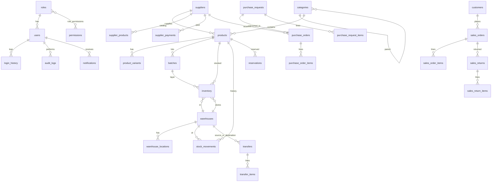

# StockPilot - Architecture, database design and plan

## 1. Architecture
```
React SPA (Vite)  --axios/JWT-->  Flask REST API  -->  services (business rules)  -->  repositories (queries)  -->  SQLAlchemy  -->  SQLite
   pages / ui / crud                routes (thin controllers)      inventory_service = single stock engine            models.py
   context (auth, theme, toasts)    schemas (Marshmallow)          purchase / sales / transfer / report services
                                    permission_required (RBAC)     notification_service (alerts + preferences)
```
* **routes/** parse + validate the request, check the permission, call a service, commit **once**, and return `{success,data,meta}`.
* **services/** hold all business rules. They only `flush`; the route commits, so one business operation = one atomic transaction (errors roll everything back via the central error handler).
* **repositories/** contain query building (filters, aggregates, FIFO layers) with no business rules.
* **Inventory model:** one `inventory` row per *(product, warehouse, batch)* = a FIFO cost layer. `stock_in` creates/increments a layer and writes a `stock_movements` row; `stock_out` consumes the oldest layers first, returns the exact cost of goods, and writes one movement per layer. Valuation = sum(layer qty x layer cost). Reservations are a separate table; *available = on hand - active reservations*.
* **Duplicate-processing protection:** status guards (state machines below) + optional idempotency keys stored in `processed_operations`.
* **Security:** password hashing, JWT access/refresh with revocation table, lockout after 5 failures/15 min, rate limiting, strict CORS, security headers, Marshmallow validation, parameterized queries, audit trail.

## 2. Feature breakdown (12 modules)
| # | Module | Backend | Frontend page |
|---|---|---|---|
| 1 | Dashboard | `routes/dashboard.py` | `Dashboard.jsx` |
| 2 | Products (variants, barcode, images, import/export) | `routes/products.py` | `masters.jsx` Products, Categories |
| 3 | Warehouses (locations, utilization) | `routes/warehouses.py` | `masters.jsx` Warehouses |
| 4 | Inventory control | `routes/inventory.py`, `inventory_service.py` | `Inventory.jsx` |
| 5 | Suppliers | `routes/suppliers.py` | `masters.jsx` Suppliers |
| 6 | Purchasing (requests, POs, receiving, invoices) | `routes/purchases.py`, `purchase_service.py` | `Purchases.jsx` |
| 7 | Sales (orders, dispatch, returns) | `routes/sales.py`, `sales_service.py` | `Sales.jsx` |
| 8 | Stock transfers | `routes/transfers.py`, `transfer_service.py` | `Transfers.jsx` |
| 9 | Customers | `routes/customers.py` | `masters.jsx` Customers |
| 10 | Reports | `routes/reports.py`, `report_service.py` | `Reports.jsx` |
| 11 | Notifications | `routes/notifications.py`, `notification_service.py` | `System.jsx`, bell in `layout.jsx` |
| 12 | Audit & settings (users, roles, backup) | `routes/admin.py` | `System.jsx`, `masters.jsx` Users |

## 3. State machines
* Purchase request: `pending -> approved -> converted` | `rejected` | `cancelled`
* Purchase order: `pending_approval -> approved -> partially_received -> received` | `rejected` | `cancelled`
* Sales order: `pending -> confirmed (stock reserved) -> dispatched (stock deducted, FIFO COGS) -> delivered` | `cancelled`; returns: `requested -> refunded (restock) | rejected`
* Transfer: `requested -> approved -> in_transit (stock leaves source) -> received (stock enters destination)` | `rejected` | `cancelled`; shortage => `discrepancy_status = open -> resolved`

## 4. Database schema

Tables (33): roles, permissions, role_permissions, users, login_history, token_blocklist, categories, suppliers, supplier_products, supplier_payments, products, product_variants, warehouses, warehouse_locations, batches, inventory, reservations, stock_movements, purchase_requests, purchase_request_items, purchase_orders, purchase_order_items, customers, sales_orders, sales_order_items, sales_returns, sales_return_items, transfers, transfer_items, notifications, audit_logs, settings, processed_operations.
Constraints: foreign keys enforced (`PRAGMA foreign_keys=ON`), unique SKU/barcode/PO/SO/transfer numbers, `UNIQUE(product, warehouse, batch)` per FIFO layer, `UNIQUE(product, batch_no)`, indexes on every foreign key and on status/date columns used in filters. Money is stored as floats rounded to 2 decimals (fine for a project; use `Numeric`/integer cents for a real accounting system).

## 5. Folder structure
```
stockpilot/
  backend/  app/{models,schemas,permissions,utils,config,extensions,bootstrap}.py  app/routes/  app/services/  app/repositories/
            tests/  scripts/make_env.py  seed.py  wsgi.py  requirements.txt  .env.example
  frontend/ src/{api.js,context.jsx,hooks.js,ui.jsx,crud.jsx,layout.jsx,App.jsx,main.jsx}  src/pages/  src/test/  package.json  vite.config.js
  docs/     ARCHITECTURE.md  API.md  CHECKLIST.md
  scripts/  setup.ps1  dev.ps1  verify_static.py  gen_api_docs.py
  .vscode/  tasks.json  settings.json
```

## 6. Known limitations
SQLite = one writer at a time (fine for a project/small team; plan a PostgreSQL move for heavy concurrent use - month grouping in dashboard/analytics uses SQLite `strftime`). Float money. Tokens in localStorage. Swagger UI assets load from a CDN. Product demo images are placeholder photos from picsum.photos with a local SVG fallback.
